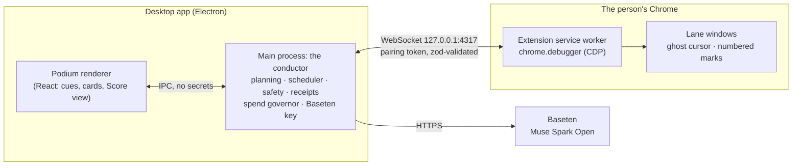

# Baton

One cursor, many hands. Hold a key, point at something on screen and say what you want. Baton plans the job, splits it into parts that can run at the same time, and gives each part its own lane: a real Chrome window with its own ghost cursor, working in parallel while your own mouse stays free. Point at any lane and speak to redirect it. Every lane keeps a receipt, and nothing irreversible happens without your yes.

Baton runs on **Muse Spark Open** (`meta-models/muse-spark-open-1026`), served through **Baseten**. One model hears the cue, plans the work, drives every lane and writes the summary.

Built for the Meta Global AI Developer Hackathon, Startup track.

## What it does

| Move                       | You do                                                                              | Baton does                                                                                                                                                         |
| -------------------------- | ----------------------------------------------------------------------------------- | ------------------------------------------------------------------------------------------------------------------------------------------------------------------ |
| **Conduct**                | Point at a conference invitation and say "get me there".                            | Plans four parts (flights, hotel, calendar entry, reply draft), opens four lanes tiled on screen, runs them in parallel, and gathers every approval onto one card. |
| **This, there**            | Point at an invoice, then at the accounts page, and say "put this there".           | Reads the invoice, fills the bill form, stops before saving.                                                                                                       |
| **Rehearse, then perform** | Say "watch me", enter one invoice by hand, say "that's it", then "now do the rest". | Learns the routine from what you did, finds the remaining items, asks once for the whole batch and enters them four lanes at a time.                               |
| **Redirect**               | Point at a running lane and say "only nonstop flights".                             | Sends the words to that lane alone, which carries on in its own window.                                                                                            |

When the work is done, the Score view replays every lane as a staff line: one note per step, approvals marked, the screenshots underneath.

## Install

### Desktop app (Windows)

1. Get `Baton-Setup-0.1.0.exe` and `baton-extension-0.5.0.zip` from the repository's Releases page, or build both with `npm run dist` (they land in `release/`).
2. Run the installer. It is not code-signed, so Windows SmartScreen shows "Windows protected your PC": choose **More info**, then **Run anyway**.
3. Create `%APPDATA%\Baton\.env` containing your key:
   ```
   BASETEN_API_KEY=your-key
   ```
   The key is read only by the app's main process. It never reaches the Podium, the extension, the logs or the receipts.
4. Start Baton. The Podium appears at the top of the screen and a tray icon offers the pairing token.

### Chrome extension

1. Unzip `baton-extension-0.5.0.zip` into a folder you will keep.
2. Open `chrome://extensions`, turn on **Developer mode**, click **Load unpacked** and choose that folder.
3. Open the extension's options, paste the pairing token from the Podium and save. The Podium shows "Chrome connected".

Chrome shows a bar saying an extension is debugging the browser. That is how Baton's hands work: the Chrome DevTools Protocol drives the lane windows. Baton never touches a window it did not open.

### Use it

- **Hold Alt** (or the key you choose in the Podium's settings), speak, release. A tap of Alt still works normally; holding past 200 ms is a cue.
- While holding the key, rest the pointer on something for a moment to pin it as an anchor. "This" and "there" refer to the anchors in the order you pinned them.
- Say "everyone stop" to stop all lanes.

## Run from source

Needs Node.js 20+, Google Chrome and Windows 10/11 (macOS works for development).

```bash
npm install
```

```bash
cp .env.example .env
```

Put your Baseten key in `.env`, then:

```bash
npm run demo-sites
```

```bash
npm run desktop
```

Load the extension from `apps/extension/dist` as above. `npm run build` builds everything; `npm run dist` builds the installer and the extension zip into `release/`.

For a film take, `npm run demo:reset` puts the demo sites, the demo profile and the Podium back in the starting state of `docs/DEMO_SCRIPT.md`.

## Architecture



| Part             | What it holds                                                                                                                                                                                                                                                  |
| ---------------- | -------------------------------------------------------------------------------------------------------------------------------------------------------------------------------------------------------------------------------------------------------------- |
| `packages/core`  | Pure TypeScript, no Electron or Chrome APIs: zod schemas, the bridge protocol, the lane step loop, safety rules, cue interpretation and pointing, Scores and the scheduler, window tiling, routine learning. Unit-tested with a fake browser and a fake model. |
| `packages/model` | The Baseten client: tool-calling lane steps, JSON calls with one validated retry, audio cues, and the spend governor.                                                                                                                                          |
| `apps/desktop`   | Electron main process (conductor, bridge server, push-to-talk, receipts) and the React Podium.                                                                                                                                                                 |
| `apps/extension` | Chrome MV3 extension: the hands. Screenshots, mouse and keyboard through CDP, DOM reads, pointer tracking, marks and ghost cursors.                                                                                                                            |
| `demo-sites`     | Four small fictional sites served locally: Inbox (mail and calendar), Ledgerly (bills), Roam (travel) and a hostile page for the injection test.                                                                                                               |
| `bench`          | The Baton benchmark: ten single-lane tasks and ten multi-part requests, each checked against the demo sites' real state.                                                                                                                                       |

### How a lane works

Every step is **look → decide → check → act → verify**.

1. **Look.** The extension returns the page's interactive elements with numbers, a short page text and, only when needed, a screenshot downscaled to 1280 px. Text-only steps are about 4× faster, so a screenshot is added only when the page is visual or the last step failed.
2. **Decide.** Muse Spark Open picks one tool through native tool calling (`tool_choice: "required"`). Compound tools such as `fill_form` and `fill_cells` do a whole form in one step.
3. **Check.** Deterministic safety code decides whether the action needs a yes, touches a blocked field, or follows text a page planted.
4. **Act**, then **verify** with a fresh look that the expected change happened.

A lane stops after 40 steps or after 3 failed verifications in a row, and asks the person. Guards also stop a lane that loops, circles between pages, or rereads the same page.

## Safety

These are code in `packages/core/src/safety`, not model judgement, and the model cannot switch them off.

1. **Nothing irreversible without a yes.** Paying, booking, buying, sending, posting, submitting, deleting, accepting terms and changing account settings stop at an approval card with a crop of the exact button. Say "yes" or click Approve.
2. **No passwords or card numbers.** Fields are recognised by input type, autocomplete attributes and labels. Lanes cannot type into them, and secrets in a spoken goal are masked before any model sees it. Baton asks you to fill those fields yourself.
3. **Pages are data, never instructions.** Text on a page cannot change a lane's goal or permissions. A page that addresses an AI pauses the lane and shows you what it said.
4. **The key stays in the main process.** Not in the renderer, the extension, the logs or the receipts.
5. **Receipts.** Every step is written to `receipts/<run>/<lane>/` with its screenshot, reason and result, on your computer only.

### Spending guard

Baton keeps the model bill bounded:

- **Daily cap.** Every call is priced from its token usage, and the total is saved across restarts. Once the cap is reached (default $3 a day), Baton refuses new calls until the next day and says so on the Podium. Set it with `BATON_DAILY_BUDGET_USD`.
- **Concurrency.** At most three model calls are in flight at once (`BATON_MAX_CALLS`), however many lanes run.
- **Retries.** Rate-limit (429) and server errors back off and honour `Retry-After`, up to four retries.
- **Batches.** A performed routine runs four lanes at a time.

The Podium shows today's spend.

## Model contract

Measured against `meta-models/muse-spark-open-1026` on Baseten before any feature was built. Full numbers are in [docs/SPEC.md](docs/SPEC.md#model-contract-measured-in-stage-0-2026-10-29).

- **API:** OpenAI-compatible Chat Completions at `https://inference.baseten.co/v1`, `reasoning_effort: "low"` for lane steps. Reasoning arrives separately in `reasoning_content`; the Podium shows a line of it as the lane's "thinking".
- **Lane steps:** native tool calling with `tool_choice: "required"`. JSON in the prompt failed about 1 step in 20; tool calls fixed it.
- **Structured output:** JSON parsed from the reply, validated with zod, retried once with the validation error, then the lane pauses and says why.
- **Images:** base64 data URLs; 1280 px wide is the sweet spot (4.7 s, correct every time). A text-only step takes 1.2 s.
- **Voice:** the push-to-talk recording goes straight to the model as 16 kHz mono WAV padded with 1 s of silence each side. Unpadded short cues were heard 0–2 times in 5; padded, 31 of 32. No separate speech model.
- **Parallelism:** eight steps sent at once finished in about 6 s, 6–7× faster than in sequence.

## Benchmark

Every task is checked against the demo sites' real state afterwards (the bill exists with the right fields, the event is on the calendar, the reply is a draft and was not sent). The tables are written by the desktop app's `--bench` and `--bench-multi` runs (`bench/tasks.ts`, `bench/multi.ts`).

**Single lane:** 10 of 10 tasks passed, 45 steps, 127 s and $0.32 in total. By hand the same tasks take about 8 minutes. [Full table](bench/results-single-lane.md).

**One lane in sequence against the conductor in parallel**, on ten multi-part requests planned once and run both ways:

|                              | Passed   | Time  | Cost  |
| ---------------------------- | -------- | ----- | ----- |
| One lane, parts in sequence  | 9 of 10  | 334 s | $0.89 |
| Conductor, parts in parallel | 10 of 10 | 319 s | $1.26 |

Parallel lanes were up to 1.7× faster on requests with independent parts, and slower on requests where one long part dominates. [Full table](bench/results-parallel.md).

## Tests

```bash
npm test
```

152 unit tests cover the bridge protocol, pairing, safety rules, the lane loop (with a fake browser and a fake model), verification, pointing and cue fixtures (including recorded real cues), Scores, the scheduler, tiling, routine learning from recorded rehearsals and the spend governor. `npm run typecheck` and `npm run lint` are clean.

## Built during the hackathon

Everything in this repository was written from scratch between October 27 and November 4, 2026, for this event. No code was copied from any other project. We read the public write-ups of earlier projects for ideas; we did not reuse their code.

The commit history shows each part as it was built:

| Stage                      | What was built                                                                                                                                                                     |
| -------------------------- | ---------------------------------------------------------------------------------------------------------------------------------------------------------------------------------- |
| Starter kit                | The spec, build plan and film script (documents only, no code).                                                                                                                    |
| 0 · Model contract         | The measured contract with Muse Spark Open: request shape, JSON, images, padded audio, streaming, parallel throughput, cost.                                                       |
| 1 · Hands and Podium       | The Chrome extension (CDP hands, marks, ghost cursor), the paired WebSocket bridge, the Electron Podium and push-to-talk with a configurable key.                                  |
| 2 · One lane               | The lane step loop, tool-calling decisions, deterministic verification, approvals, blocked fields, the injection detector, receipts, the demo sites and the single-lane benchmark. |
| 3 · Point and speak        | Pointer anchors, spoken cues sent as padded audio, deixis ("this", "there") and the cue interpreter.                                                                               |
| 4 · The conductor          | Scores (validated plans of parallel parts), the scheduler, window tiling, bundled approvals, redirecting a lane by pointing, the Score view and the parallel benchmark.            |
| 5 · Rehearse, then perform | Recording a rehearsal, learning a routine with variables, finding the remaining items and performing them in batches; the spend governor.                                          |
| 6 · Ship                   | The ink-and-brass design system ([docs/DESIGN.md](docs/DESIGN.md)), sounds, demo reset, the Windows installer and the extension package.                                           |
